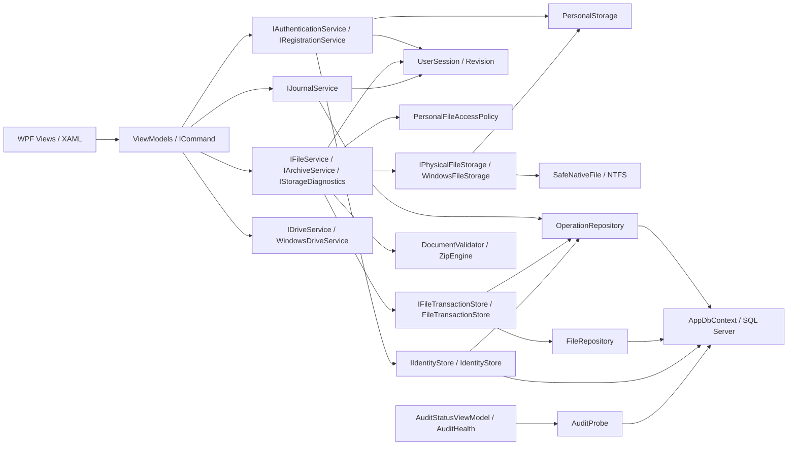
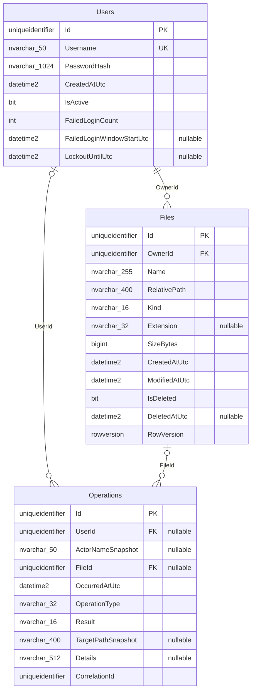

# Архитектура Secure File Manager — итоговая C#-версия

Дополнение11.02 от07.11.2026: общий редактор получает ITextDocumentService (личный
IFileService наследует порт); ExternalDocumentService и WindowsExternalDocumentStorage
обслуживают внешние TXT/JSON/XML. ExternalDocumentStore в Data координирует общие
метаданные ExternalDocuments и Operations.ExternalDocumentId/ExternalPathSnapshot.
Третья добавочная миграция — 20261107101211_AddExternalDocuments. Изоляция личных
Files/Users сохранена. Схема и in-place backup/recovery-протокол подробно приведены
в [EXTERNAL_EDITOR](EXTERNAL_EDITOR.md); старые диаграммы ниже — снимок MVP.

Дополнение07.11.2026: реализован общий read-only браузер внешних локальных папок —
IComputerBrowseService/ComputerBrowseService в Core, WindowsComputerDirectoryReader
и ComputerBrowserView/VM в Wpf, вкладка раздела «Диски». Видимость общая по Windows ACL,
личная Files не усваивает внешние объекты. Это первый шаг11.01 нового объёма;
изменяющие внешние операции/новая metadata model ещё не реализованы.
Остальная схема/слои ниже описывают сохранённый MVP. См. [COMPUTER_BROWSER](COMPUTER_BROWSER.md).

Снимок: HEAD `598b175` и документационный этап 09–10 от 03.11.2026.
Приложение локальное, Windows/WPF; внешнего API, облака, режима B и фоновой службы нет.
Исторические предложения в STORAGE_ARCHITECTURE не означают наличие Locations/grants.

## Слои и компоненты

| Проект | Ответственность / зависимости |
|---|---|
| SecureFileManager.Core | Entities, interfaces, результаты, auth/session/access, FileService, DocumentValidator, ZipEngine, JournalService; без EF/WPF/SQL |
| SecureFileManager.Data | AppDbContext, mapping/migrations, repositories, IdentityStore, FileTransactionStore, AuditProbe; ссылка только на Core |
| SecureFileManager.Wpf | Views, VM, ресурсы, Windows IO/native handles, диалоги, DI composition root; Data используется при составлении графа |
| SecureFileManager.Tests | xUnit: unit, настоящий SQL Express, Windows FS и WPF STA/layout |

Microsoft.Extensions.DependencyInjection — единственный DI-контейнер. `App.CreateServices`
и `AddSecureFileManagerData` — composition root. UserSession, FileService, health, VM,
Windows adapters — singleton; окна transient, контексты создаются фабрикой и освобождаются.
IFileService/IArchiveService/IStorageDiagnostics ссылаются на **один** FileService;
IFileDialogs/IArchiveDialogs — на один WindowsFileDialogs. Общий редактор не создаёт
несколько независимых буферов одного FileId. Views выполняют только техническое UI-поведение.

## Контракты сервисов

| Порт Core | Команды / данные |
|---|---|
| IAuthenticationService / IRegistrationService | LoginAsync, LogoutAsync / RegisterAsync; AuthOutcome |
| IUserSession | Current SessionIdentity(Id, Username), Revision, Changed |
| IUserStorageService | PrepareCurrentAsync, CheckPathAsync, CheckFileAsync; StorageOutcome |
| IFileService | List/Create/Read/Reload/Save/Validate/Delete/Synchronize/Import/RecoverAsync, Changed, WaitForIdleAsync |
| IArchiveService | CreateArchiveAsync, PreviewArchiveAsync, ExtractArchiveAsync; progress/cancellation |
| IStorageDiagnostics | DiagnoseAsync; bounded отчёт, без автоматического исправления |
| IJournalService | собственная страница по JournalQuery, без доверенного UserId из UI |
| IFileAccessPolicy / IPathPolicy | actor == owner / разрешение личного относительного пути |
| IPhysicalFileStorage / IFileWorkspace | Open(owner), List/Inspect/Read/OpenBinary, Stage/StageGenerated/Publish/Settle/Pending |
| IFileTransactionStore | ExecuteAsync(owner, callback), HasSuccessAsync(owner, correlation) |
| IIdentityStore | ExecuteAsync с транзакционным решением Commit |
| IAuditService / IAuditProbe / IAuditHealth | запись безопасного события / проверка INSERT с rollback / фактическое состояние |

Авторизующие команды не принимают доверенный owner из UI. IPathPolicy/provisioner/workspace
— инфраструктурные порты, не самостоятельные публичные пользовательские команды.
Исходные сигнатуры и DTO находятся в Core/Interfaces, Core/Files, Core/Journal.

## SQL Server и актуальная схема

EF Core SqlServer 9.0.22, два Up migration: InitialCreate и AddLoginFailureWindow.
На запуске WPF миграции не выполняются. `has-pending-model-changes` 03.11.2026 подтвердил
соответствие модели последней миграции. Ниже физические типы SQL; `?` означает NULL.

Все PK — GUID, FK — NO ACTION. Files включает каталоги (`Kind=Directory`), дерева
ParentId нет: используется канонический относительный путь с `/`. Физические байты в БД
не хранятся. Системная `__EFMigrationsHistory` хранит версии миграций.

| Таблица | Индексы и SQL CHECK |
|---|---|
| Users | unique Username; CHECK trimmed length 3..50, nonempty hash, FailedLoginCount >=0; IsActive default true |
| Files | OwnerId; filtered unique (OwnerId,RelativePath) WHERE IsDeleted=0; CHECK SizeBytes>=0, Kind File/Directory, nonempty Name/RelativePath, согласованность IsDeleted/DeletedAtUtc, ModifiedAtUtc и DeletedAtUtc не раньше CreatedAtUtc |
| Operations | (UserId,OccurredAtUtc), (OperationType,Result), FileId, CorrelationId; CHECK Result Success/Denied/Failed и 14 разрешённых OperationType |

Username и RelativePath: Latin1_General_100_CI_AS (case insensitive, accent sensitive).
Длины путей до 400 оставляют unique-key в пределах лимита SQL. Files скрывает soft-deleted
строки query filter; физического каскада удаления нет, исторический FileId сохраняется.
RowVersion — обязательный optimistic concurrency token при update/delete.
AppDbContext отклоняет не-UTC DateTime, восстанавливает Kind UTC при чтении datetime2;
превращает Remove(FileRecord) в soft-delete, запрещает изменение/удаление Operations
и удаление Users через SaveChanges. SQL-администратор этими правилами не ограничен.

## Auth, сессия и доступ

PasswordSecurity использует ASP.NET IdentityV3 PBKDF2, случайную соль и параметры
в формате хеша, production cost 600000. Verify поддерживает RehashNeeded; обновление
происходит при успешном входе вместе с аудитом. Неизвестный/непригодный аккаунт проходит
dummy verify; сообщение одинаково для неверных данных. Политика: 5 ошибок за 15 минут,
блокировка 15 минут, SQL-сериализация счётчиков между экземплярами сервисов.
Регистрация готовит GUID-каталог, User и обязательный аудит; неуспех не объявляется регистрацией.

Session.Start происходит после успешного SQL commit. Выход очищает сессию даже при
невозможности аудита. Revision проверяется после await, поздние ответы старой сессии
отбрасываются; VM/фильтры/выделение/буферы очищаются. Выход сначала согласует закрытие
редакторов и дожидается файловой операции. Авторизация повторяется в сервисах:
сессия, active SQL User, actor==owner, owner-scoped ID/путь и физическая граница.
Скрытая кнопка сама по себе не является защитой.

## Физическое хранилище и алгоритмы операций

StorageRoot обязателен и конфигурируется вне бизнес-логики. Только локальный абсолютный
каталог, далее `Users/<GUID>`. PersonalStorage и RelativePathSyntax запрещают traversal,
absolute/UNC/device/ADS/зарезервированные имена; WindowsFileStorage/SafeNativeFile
перепроверяют конечный путь handle, reparse points, число hard links, удерживают предков.
`.sfm-internal` зарезервирован для marker/lock/планов/staging, UI его скрывает.
Windows ACL не переписываются; разных app-пользователей один Windows token не изолирует.

1. FileService.Run захватывает gate, фиксирует session/revision, открывает SQL-транзакцию
   и active-user lock; Windows workspace имеет собственный lock. Pending plan блокирует
   обычную операцию до проверяемого восстановления.
2. Проверяются ownership/путь/состояние; новые байты готовятся в private staging через
   CreateNew и Flush(true). Сохранение сверяет identity/SHA-256 и SQL RowVersion.
3. План сохраняется до публикации; rename без replace публикует результат. При Save
   исходник уходит в backup; между двумя rename возможен короткий gap.
4. Files и Operations фиксируются на одной connection/Serializable-транзакции
   (`UPDLOCK,HOLDLOCK` по пользователю). Автоповтора IO callback нет.
5. При подтверждённом commit убираются собственные backups/staging. При rollback
   компенсируется только результат, совпадающий с планом. При ambiguous commit ищется
   успешный FILE_TX_* по owner/correlation; неизвестность даёт RecoveryRequired.

Delete перемещает объект в служебный backup, soft-delete и аудит фиксируются вместе;
окончательная очистка после commit. Непустая папка не удаляется рекурсивно.
Импорт — узкое исключение чтения выбранного внешнего локального источника: источник
не изменяется, путь не сохраняется в аудите; сеть/ссылки/источники внутри Storage запрещены.
Сверка явная, диагностика не присваивает неизвестные файлы и не удаляет их.
Подробный протокол и восстановление: [FILE_OPERATIONS](FILE_OPERATIONS.md).

## Форматы и ZIP

TXT/JSON/XML — строгая UTF-8 до 10 МиБ. System.Text.Json: без comments/trailing commas,
глубина 64. XmlReader: DtdProcessing.Prohibit, XmlResolver=null, byte/character/depth/node/
attribute limits; произвольная активация типов и BinaryFormatter не используются.
Синтаксически неверный документ можно исправить, запрещённый DTD не открывается;
невалидное сохранение не публикуется. Ошибки не повторяют фрагменты документа.

ZipEngine получает потоки, не выбирает OS-пути. Проверяет envelope/central/local headers,
flags/methods/имена/конфликты/ссылки, declared limits, actual streaming bytes и CRC.
До allocations — <=250 записей, central directory <=1 МиБ, вход <=101 МиБ;
<=25 МиБ/entry, <=100 МиБ total, <=100:1 ratio. Выходные узлы тоже ограничены.
Create пишет Store; Extract поддерживает Store/Deflate. ZIP64/encrypted/multipart отвергаются.
Extract готовит целое дерево и публикует новым root rename, затем общие Files+audit;
нет merge/overwrite. Tree-plan содержит identity/hash для безопасной компенсации.
Preview проверяет структуру и заявленные величины, CRC/actual output проверяются при Extract.

## Аудит и ошибки

Operations хранит UTC, nullable actor/file, снимок собственного пути, тип/результат,
безопасный код и correlation. Полная карта событий: [STAGE08_SECURITY_AUDIT](STAGE08_SECURITY_AUDIT.md).
JournalService берёт пользователя из сессии; фильтры, sort, Skip/Take выполняются в SQL,
UI page 50, максимум page size 100. Чужие/system события не выдаются.
Неизвестный historical Details редактируется при проекции, сырой текст не отображается.

AuditProbe проверяет SELECT+INSERT с rollback, AuditHealth учитывает реальные записи и
commit, latches failures, истечение evidence через 2 минуты. UI timer обновляет надпись,
не запускает фоновые SQL-операции. «Журнал активен» — последнее свидетельство, не гарантия
будущего commit. Невозможный аудит не заменяется Console.WriteLine; операция блокируется
либо компенсируется. Ошибка записи события не выдаётся за записанное событие.
FileResult/AuthOutcome/RepositoryResult передают безопасный статус, а не exception/секреты.

## Конкурентность, диагностика и модель угроз

Gate/SQL locks/Windows handles/CreateNew/RowVersion/hash ограничивают гонки. Проверка
состояния snapshot не гарантирует невозможность будущего внешнего изменения.
Bounded Diagnose (10000 объектов/записей) обнаруживает missing/untracked/changed/deleted
remnants/pending/audit mismatch; неполнота явно маркируется. Без исторического hash
одинаковые size/mtime не доказывают равенство байтов. Журнал не имеет криптографической цепочки.
SQL и NTFS — два ресурса: полного power-loss recovery и распределённой атомарности нет.
Отдельная physical file symlink/реальное заполнение диска/power loss не воспроизводились;
есть реальные junction/hardlink и контролируемые отказы. Windows/SQL administrator,
владелец процесса и прямой доступ к диску/БД вне threat boundary. Шифрования at rest нет.

Эта документация фиксирует C#-контракты для воспроизведения требований в будущем;
Python-код, новая схема или режим B сейчас не разрабатываются.
