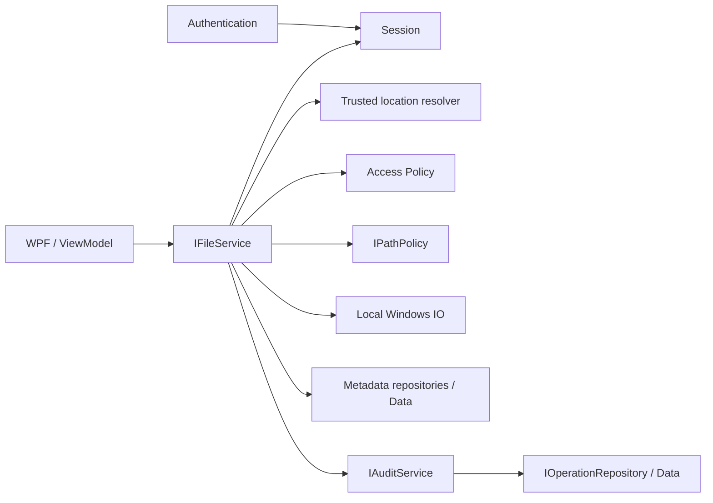

# Архитектура хранения и расширение A → B

Дополнение11.02: реализован общий внешний редактор без личного OwnerId в новой
ExternalDocuments. Физическая запись сохраняет ACL/identity исходника через write handle;
backup/plan находятся в StorageRoot/.external-editor, recovery сверяет SQL correlation+path
и не откатывает чужой committed save. In-place write/аварийные ограничения и схема —
[EXTERNAL_EDITOR](EXTERNAL_EDITOR.md). Личный режимA сохранён; move/rename/delete ещё не реализованы.

**Актуализация07.11.2026:** пользователь разрешил общую видимость внешних файлов
всем пользователям приложения. В11.01 реализован read-only IComputerBrowseService
поверх локального WindowsComputerDirectoryReader, без Locations/grants и без auto-adopt
в личную Files. Это достаточная граница для общего просмотра, не реализация mutating B.
Прежние предложения по общей идентичности/транзакциям нужно уточнить перед11.02–11.04.
Личный Storage и все ограничения его режимаA сохранены; публичный браузер не входит в него.
Подробности и проверки — [COMPUTER_BROWSER](COMPUTER_BROWSER.md). Остальной текст ниже
содержит исторический анализ и актуализации соответствующих этапов.

**Этап:** 03.5, архитектурная подготовка. **Дата:** 01.11.2026.
**Исходный результат 03.5:** анализ и план без изменения кода/БД.
**Актуализация этапа 04:** реализованные компоненты и текущие границы — раздел 13.

## 1. Решение и границы

Ближайшие этапы реализуют **только A — Personal Secure Storage**. B — потенциальное,
отдельно согласуемое расширение. Возможность расширения не означает готовую поддержку B.
Не добавляются переключатель режима, разрешённые папки Windows, роли глобального
доступа, новые проекты, провайдеры, фоновые наблюдатели и миграции «на вырост».

Текущие TECHNICAL_SPEC.md (1.2/1.3, 3.1, FR-02/03, SEC-02/03) и AGENTS.md ограничивают
операции собственным хранилищем. B расширит эту границу, а импорт потребует узкого
исключения для чтения выбранного источника. **Сейчас исключения не вводятся.**
Перед реализацией импорта/B нужно явно согласовать и документированно обновить
соответствующие FR/SEC и инструкции доступа; не трактовать этот документ как обход ТЗ.
Формальный вопрос допустимости стека у преподавателя не считается решённым этим анализом.

Архитектура пригодна как основа перехода, но несколько расположений нельзя получить
простой заменой строки корня: потребуются расширения каталога, политик и аудита.
К началу этапа 04 для A архитектурных блокеров не обнаружено.

## 2. Состояние проекта при анализе этапа 03.5

| Компонент | Что существует | Значение для расширения |
|---|---|---|
| Core | User, FileRecord, Operation, три интерфейса репозиториев, RepositoryResult | Нет ссылок на EF/WPF/SQL; идентичность пользователя отдельно от пути |
| Data | AppDbContext, SQL mapping, миграция, три репозитория, фабрика контекста/DI | SQL изолирован; доступ к метаданным не равен доступу к физическому файлу |
| Wpf | Шесть Views/VM, навигация, styles/resources; Data только в App.xaml.cs | Нет файловых/SQL-операций в Views/VM; тему и композицию можно сохранить |
| Tests | Проверки метаданных, ограничений SQL, навигации и WPF | Хорошая регрессионная основа; проверок физической границы/ACL пока нет |

В Core/Interfaces сейчас **только** IUserRepository, IFileRepository,
IOperationRepository. IAuthenticationService, IFileService, IPathPolicy, IAuditService,
IDriveService, IClock упомянуты в ТЗ как проектные, но ещё не реализованы.
Сессии, политик доступа, определения физического корня и файлового сервиса нет.
Жёсткой привязки работающей бизнес-логики к Storage/Users не обнаружено: самой
файловой бизнес-логики ещё нет. WPF-строки «Моё хранилище» — текст заготовок, не policy.

Проверенные точки расширения и ограничения:

- IFileRepository принимает ownerId/OwnerId и фильтрует ID/путь по владельцу. Он не
  удостоверяет, откуда получен ownerId. Этот параметр нельзя брать из формы/выбора UI.
- FileRecord не содержит физический путь; это подходит A. Но нет LocationId,
  поэтому один и тот же RelativePath у одного владельца в двух корнях неразличим.
- OperationRepository.AddAsync при FileId требует Files.OwnerId == Operation.UserId,
  включая soft-deleted Files через IgnoreQueryFilters. Это корректная граница A,
  но она отклонит событие разрешённого доступа другого пользователя в общем B-каталоге.
- Репозитории создают отдельные DbContext на вызов. Они не предоставляют общей
  транзакции изменения метаданных и добавления аудита. До файловых записей этапа 05
  нужен явно выбранный способ координации SQL-транзакции и компенсации IO.
- IUserRepository пока не обновляет FailedLoginCount/LockoutUntilUtc/IsActive:
  необходимое атомарное обновление для этапа 04 следует добавить тогда, не сейчас.
- VM зарегистрированы singleton. При появлении сессии выход/смена пользователя должны
  очищать списки, выбранные записи, редакторы и кэши, а не только менять подпись логина.
- FileListItem пока содержит только display-поля. В этапе 05 нужен непрозрачный ID
  записи; в B также ID расположения. Нельзя выполнять действие, восстанавливая путь
  из отображаемого имени, или передавать абсолютный путь из строки таблицы как доверенный.

## 3. Вариант A — личное хранилище

Пользователь приложения имеет стабильный User.Id (GUID). Доверенный резолвер строит
его корень из конфигурации приложения и этого ID: Storage/Users/{UserId}/.
Имя логина не является частью физического пути. Единственное расположение пользователя
пока может быть логическим объектом без таблицы StorageLocations.

Содержимое — на диске; Files хранит метаданные и путь относительно корня пользователя;
Operations — события. Аутентификация сама не выбирает каталог и не открывает файлы.
Создание/проверка личного корня — отдельная ответственность сценария инициализации
рабочей области; не переносить её в проверку пароля или ViewModel входа.

Каждая операция получает текущую сессию, проверяет владельца и физическую границу
через сервисы. Обращение по FileId не пропускает эти проверки. Изменения без готовой
БД/аудита запрещены; последующий отказ записи требует ошибки согласованности/компенсации,
не ложного Success. RowVersion метаданных не гарантирует неизменность содержимого на диске.

Раздел «Диски» использует будущий IDriveService только для характеристик накопителей.
Буква диска в этом разделе не становится разрешённым файловым корнем.

## 4. Вариант B — разрешённые каталоги Windows

B работает только с явно зарегистрированными локальными расположениями. По умолчанию
нет ни одного внешнего разрешения. Выбор пользователя в UI не равен выдаче разрешения.
Нельзя автоматически разрешать весь диск, системные папки или профиль другого пользователя.
Политику регистрации/изменения разрешённых корней определяет доверенная конфигурация,
не произвольная строка TextBox и не глобальная административная роль приложения.

Перед B нужно решить: каталоги строго личные или один каталог доступен нескольким
пользователям приложения. До решения пересекающиеся/дублирующие корни не разрешать:
иначе один физический файл получит неоднозначные метаданные, права и аудит.
UNC, сетевые/устройственные пространства имён и особые пути не разрешать автоматически.

Условие доступа: действующая сессия **и** разрешение приложения на конкретное действие
в расположении **и** допустимая физическая цель **и** успешный доступ Windows.
Чтение, запись, создание, удаление проверяются отдельно. Проверка ACL корня или чтения
не доказывает разрешение записи/удаления дочернего файла. Авторитетна фактическая
операция ОС; предварительная проверка не исключает последующего отказа.

Учётная запись приложения не тождественна Windows SID. В обычном WPF-процессе
проверка ОС использует security context процесса/потока, а не User.Id из SQL.
Пароль приложения не даёт Windows-токен. Поэтому приложение не должно обещать разные
Windows ACL для двух своих пользователей под одной учётной записью ОС. Повышение прав,
impersonation, обход ACL и изменение разрешений автоматически не предусматриваются.
Основание: [модель файлового доступа Windows](https://learn.microsoft.com/en-us/windows/win32/fileio/file-security-and-access-rights).

В B данные могут изменяться внешними программами. Понадобится сверка наличия,
изменений, конфликтов и устаревших метаданных по запросу пользователя. Фоновый watcher
не входит в это решение. Отсутствие/недоступность файла не означает автоматически
успешное удаление; события аудита фиксируют фактический результат приложения.

## 5. Общие компоненты и предлагаемые контракты

Таблица — **проектное разделение**, не список добавленных интерфейсов C#.

| Компонент | Ответственность | Когда и что использовать |
|---|---|---|
| Authentication | Проверка учётных данных, KDF, блокировка, состояние учётной записи | IAuthenticationService из ТЗ, этап 04; без путей и выбора режима A/B |
| Session | Текущая подтверждённая идентичность, смена/выход | Узкий IUserSession/аналог при реализации 04; UI читает ID/логин, не User с PasswordHash |
| Access Policy | Разрешено ли действие текущей идентичности над целью | IFileAccessPolicy обоснован в 04.05: ownership для A, grants для B; не смешивать с проверкой пароля |
| Storage Location | Доверенный корень, стабильная идентичность расположения, вид/ограничения | Для A один резолвер личного корня; интерфейс каталога пока не нужен |
| Path Policy | Имена, относительный путь, физическая граница, ссылки, итоговая цель | IPathPolicy из ТЗ в 04.05; принимает доверенный контекст корня, не создаёт сессию и не выдаёт права |
| File Operations | Сценарий открытия/создания/изменения/удаления | IFileService из ТЗ в 05; оркестрирует сессию, policy, локальный IO, метаданные и аудит |
| Audit | Актор из сессии, безопасные сведения, правильный результат и UTC | IAuditService из ТЗ поверх существующего IOperationRepository; этап 04 и последующие |

**IStorageProvider не добавлять:** A и B используют один локальный файловый механизм;
разница в разрешённых корнях/правах, не в SQL provider или облачном backend. IFileService
закрывает потребность VM. Дополнительный low-level IO-контракт вводить только при
реальном сценарии замены реализации/тестирования, без дублирования orchestration.

**IStorageLocationPolicy сейчас не добавлять:** для одного личного корня достаточно
доверенного резолвера и IPathPolicy. Когда появятся несколько расположений и разрешения
на их регистрацию/использование, отдельный каталог/политика расположений будет обоснован.
Тогда он отвечает за доступные LocationId/корни, IPathPolicy — за цель внутри корня,
IFileAccessPolicy — за действие над целью. Не реализовывать три одинаковых проверки пути.

**IFileAccessPolicy обоснован, но отложен до 04.05:** это отдельное решение о доступе,
не замена авторизации путями и не набор условий в кнопках. В 03.5 нет потребителя
контракта, поэтому не создаются пустой интерфейс и реализации AlwaysAllow/заглушки.

Публичные контракты в Core не принимают EF DbContext, WPF controls, SqlConnection
или Windows access-token types. Нативные детали — в адаптере. При необходимости WinAPI
в рамках текущих трёх проектов допустим тонкий Wpf/Infrastructure/FileSystem,
реализующий Core-контракт; без бизнес-решений в Views/VM. Data остаётся Persistence.
Место и минимальный IO-контракт уточняются при фактическом сценарии, не созданием
ещё одного проекта заранее. Composition root — по-прежнему App.xaml.cs.

## 6. Поток операции и единый интерфейс

Предлагаемый поток будущих этапов; сейчас отсутствующие сервисы не вызываются:

1. Сервис получает актора из сессии; внешний запрос содержит FileId либо непрозрачную
   ссылку на расположение и относительный путь, не «доверенный» OwnerId/абсолютный путь.
2. Загружает метаданные/доверенный корень, проверяет действие и физическую цель;
   порядок проверок не должен раскрывать существование чужого объекта.
3. Проверяет условия работы с БД/аудитом; открывает файл с минимальными правами,
   безопасным FileMode, повторными/handle-проверками и обработкой конкурентного доступа.
4. Координирует запись метаданных и аудита в одной SQL-транзакции там, где это нужно.
   Текущие независимые вызовы репозиториев сами в одну транзакцию не объединяются.
   Выбрать минимальный транзакционный сценарий Data до реализации записи в 05.
5. IO не становится частью общей атомарной SQL-транзакции. Нужны staging/компенсация,
   сверка и честный результат при частичной ошибке. Проверка доступности БД заранее
   не гарантирует, что аудит удастся записать после IO.

При добавлении B сохраняются те же Authentication/Session, формы и оформление WPF.
Меняются доступные расположения, breadcrumb и разрешённость действий, а не проверка
пароля. VM работает с display-моделью и непрозрачной ссылкой на файл; не делает SQL,
GetFullPath или проверку ACL. Кэш/выбор привязаны к пользователю и расположению,
очищаются при выходе/смене пользователя. Разрешённость кнопки — подсказка, сервис
всегда проверяет права повторно. Для будущего редактора нужен контроль несохранённых
изменений при навигации; сейчас отдельный navigation framework не требуется.

## 7. Пути и физическая безопасность

MetadataPath в AppDbContext проверяет **синтаксис метаданных**, включая разделитель `/`,
недопустимые сегменты/имена и длину. Он не открывает объект, не проверяет ACL или
reparse points и не заменяет IPathPolicy. FileRecord.RelativePath не принимает
абсолютный путь Windows. Заменить его на физический путь означало бы ослабить A.

| Проверка | A | B |
|---|---|---|
| Источник корня | Конфигурация приложения + Session.UserId | Доверенный каталог разрешённых расположений |
| Право приложения | Только собственный корень/OwnerId | Явное разрешение на расположение и действие |
| Путь запроса | Относительный путь или FileId | LocationId + относительная ссылка или FileId |
| Граница | Личный физический корень | Конкретный зарегистрированный физический корень |
| Права Windows | Необходимы, не подменяют ownership | Необходимы вместе с app policy |
| Метаданные/внешние изменения | Управляемая область, возможна рассинхронизация | Внешние изменения ожидаемы; нужна явная сверка |

Проверять нормализацию и границу по сегментам, а не StartsWith строки:
папка Users/12-other не является дочерней Users/12. Отвергать traversal, абсолютные/
drive-relative/root-relative пути, ADS, device namespaces и неподдержанные варианты.
Проверять все компоненты физической цепочки, включая сам корень, ссылки/junctions,
последний существующий родитель при создании и цель открытого объекта. Обрабатывать
подмену между проверкой и открытием; не полагаться на File.Exists + File.Open.

Hard link может давать несколько путей к одному файлу: одного контроля reparse points
для изоляции объектов недостаточно. Нужна отдельная политика ссылок/идентичности объекта
для записи, отказ при невозможности подтвердить границу; не обещать защиту от локального
администратора. См. [hard links/junctions](https://learn.microsoft.com/en-us/windows/win32/fileio/hard-links-and-junctions)
и [правила имён Windows](https://learn.microsoft.com/en-us/windows/win32/fileio/naming-a-file).
Никакие эти физические проверки не заявляются уже реализованными.

## 8. RelativePath и потенциальная схема нескольких расположений

Сейчас: RelativePath nvarchar(400), collation Latin1_General_100_CI_AS; уникальный
индекс **(OwnerId, RelativePath) WHERE IsDeleted = 0**. Путь относителен единственному
личному корню, а не каталогу процесса и не букве диска. Это достаточно A.
После soft-delete тот же путь получает новый FileId, прежние события сохраняются.

При двух корнях у одного пользователя Documents/report.txt должен различаться
по расположению. Нельзя кодировать букву диска/корень в OwnerId, имя пользователя
или искусственный префикс RelativePath. Для реальных нескольких корней потребуется
**новая** миграция, не редактирование InitialCreate:

- StorageLocations: стабильный Id, Kind, DisplayName, доверенная привязка корня
  (например RootBindingKey к защищённой конфигурации), IsEnabled и выбранная политика.
  Абсолютные корни не вводятся произвольно через UI и не попадают в журнал/секреты Git.
- Files.LocationId → StorageLocations, без каскадного удаления; RelativePath остаётся
  относительным. Для личных непересекающихся корней можно сохранить OwnerId и unique
  **(OwnerId, LocationId, RelativePath) WHERE IsDeleted = 0**; связь должна также
  гарантировать соответствие владельца расположения владельцу файла.
- Для общего корня B нужно отдельно согласовать модель: один каталог файла на
  расположение, unique **(LocationId, нормализованный относительный путь)** и
  StorageLocationGrants(UserId, LocationId, действия). Не выдавать текущий OwnerId
  за владельца Windows ACL; регистратора/владельца метаданных и разрешённого актора
  различать явно. Не создавать несколько независимых записей одного объекта без
  решения конфликтов. Это более значительное расширение, не задача этапа 04.
- Аудиту нужна идентификация расположения/безопасный снимок имени/вида, чтобы одинаковые
  относительные пути не смешивались. UserId — инициатор, FileId может быть NULL.
  Для разрешённого общего доступа потребуется изменить проверку actor==file.OwnerId
  и scope чтения каталога/репозиториев; не просто удалить существующую проверку.
  Сохранить A-проверки и добавить новые тесты policy/grants перед включением B.

SQL CI_AS не является универсальным эквивалентом идентичности файловой системы.
Внешние каталоги могут иметь иной регистр/правила имён; путь может превышать 400 символов.
Начальная поддержка B должна явно отклонять неподдержанные случаи либо получить новую
схему сравнения/индекса и тесты. Не обрезать пути/не переводить всё безусловно в lower.
Увеличение nvarchar требует пересмотра ширины индекса; hash-ключ сам по себе без проверки
совпадения полного нормализованного пути не решает коллизии. Пока ничего этого не менять.

RootBinding не должен незаметно переопределять прежний LocationId на чужое дерево.
Перенос/изменение корня — отдельная контролируемая операция с проверкой метаданных
и сохранением смысла истории либо регистрация нового расположения.

## 9. Импорт существующего файла в A — отдельный будущий сценарий 05.10

Импорт копирует содержимое выбранного существующего файла в личный корень. Он **не**
регистрирует Windows-папку как рабочее расположение B, не даёт постоянный доступ к ней
и не перемещает/не удаляет источник. На первом шаге не нужен рекурсивный импорт папок.

После согласованного уточнения FR/SEC: источник — узкое разрешение на чтение выбранного
локального файла с учётом Windows-доступа/ссылок; назначение — только проверенный A-корень.
Источник не проходит как «RelativePath внутри Storage» и не получает произвольные
CRUD-возможности. Выбор диалогом не отменяет проверки фактического открытого объекта.

Сервис проверяет сессию, источник/назначение, имя/конфликт, квоты/место, ограничения
на ссылки, реальные скопированные байты, отмену и конкурентное изменение источника.
Ограничения размера/типов требуется определить до реализации, не брать лимит
текстового редактора как автоматический общий лимит импорта. Копирование через
staging, без перезаписи существующего файла; ошибка/отмена очищает только свои временные
файлы. Метаданные фиксируют владельца и путь **назначения**, не внешний абсолютный путь.

Для результата созданного файла можно использовать FILE_CREATED + безопасный код
IMPORT и CorrelationId; новый тип события вводить только при обоснованной необходимости
с обновлением CHECK новой миграцией. Сырой внешний путь/содержимое в Details не писать.
Проверки: отказ чтения, занятость/смена источника, конфликт имени, ссылка, нехватка
места/квота, отказ БД/аудита после частичного копирования, сохранность исходного файла.

## 10. Аудит и риски, требующие проверок будущих этапов

| Риск | Требуемое поведение |
|---|---|
| Смешение аутентификации и ownership | Auth устанавливает личность; policy проверяет действие заново; логин не выдаёт путь |
| Подмена ownerId/LocationId/FileId | Актор из сессии, корень из доверенного каталога, проверки в сервисе для каждого запроса |
| Два пользователя приложения в одном Windows-профиле | App policy не подменяется общими ACL процесса; граница модели угроз явно ограничена |
| Traversal/ссылки/подмена объекта | Физическая граница и безопасное открытие, не только синтаксис строки/предварительный ACL |
| Ошибка/конкуренция SQL или IO | Нет ложного Success; SQL-координация, компенсация и сверка; RowVersion не защищает внешний файл |
| Отказ/действие по чужому файлу в A | Безопасный ACCESS_DENIED; FileId=NULL, если связанный FileId не разрешён текущим контрактом; не подставлять владельца как актора |
| Смешение корней и истории B | Стабильная идентичность расположения и безопасные snapshots; новые grants и тесты перед общим доступом |
| Смена пользователя | Очистка singleton VM/кэшей/выбора и закрытие чувствительных экранов |
| Прямой доступ к диску/SQL администратора | Не обещать защищённость клиентской WPF-политики от привилегированного обхода |

При отклонённом опасном пути TargetPathSnapshot может быть NULL: текущий Data валидирует
его как безопасный относительный путь. Details содержит код причины, а не сырой ввод.
Не обходить owner-проверку аудита, записывая событие от имени другого пользователя.

## 11. План перехода без потери A

1. В этапе 04 реализовать A-auth/session, ownership и IPathPolicy независимо от UI,
   алгоритма пароля и строки Storage/Users. Провести негативные проверки двух пользователей.
2. В 05 реализовать IFileService для A, согласование файлов/SQL/аудита и выбранный
   транзакционный сценарий; импорт 05.10 — только после уточнения его исключения FR/SEC.
3. Рассматривать B лишь после отдельного разрешения и уточнения требований преподавателя:
   какие локальные корни, действия, пользователи, общие каталоги и правила Windows допустимы.
4. Проектировать новую схему на копии/отдельной тестовой БД. Сделать резервную копию;
   добавить LocationId сначала совместимым способом, зарегистрировать по личному
   расположению для существующих OwnerId, заполнить Files (включая soft-deleted записи)
   без изменения Id/путей/содержимого.
5. Проверить заполнение, отсутствие неоднозначных корней/коллизий и сохранность FK/
   soft-delete/аудита; лишь затем менять unique-индексы и делать необходимые поля required.
   Старые Operations не переписывать ради выдуманного снимка: LocationId может остаться
   NULL для исторических/безобъектных событий, старые snapshots и UTC сохраняются.
6. Расширить scoped-запросы, location/access policy и аудит; A оставить неизменным
   сценарием с собственными тестами. Не вводить глобальный обход ownership.
7. В том же WPF добавить только отображение доступного расположения/контекста;
   переиспользовать таблицы, команды и тему. Нельзя связывать «Диски» с полным деревом Windows.
8. Прогнать A-регрессию и отдельные B-тесты на безопасных каталогах: ACL-отказы,
   выход из корня, ссылки, пересечения, внешние изменения, отмена, отказ SQL и аудит
   актора, не являющегося владельцем метаданных. Откат развёртывания не удаляет новые
   пользовательские данные; не выполнять destructive Down вслепую.

До отдельного решения B не включается, Files и InitialCreate остаются прежними.
Переписывать Authentication/Session при B не требуется при соблюдении этих границ;
catalog/access/path/audit и persistence потребуют целевых дополнений, не обещается
полностью «подключаемый» B без изменений модели.

## 12. Проверка этапа 03.5

Сопоставлены csproj-зависимости, Core/Interfaces/Entities, AppDbContext/migration snapshot,
репозитории и их тесты, DI, VM и документы. В документе отличены существующие типы от
предложений. Физический Windows-доступ/ACL здесь не тестировался и не реализован.
Изменена только документация; restore/build/test, SQL-команды и GUI не запускались.
Проверки согласованности и git diff --check фиксируются в PROGRESS.md.
Этап 04 не начат, Git-коммит не создан.

## 13. Актуализация после реализации этапа 04 (01.11.2026)

Разделы 2–12 фиксируют исходный анализ этапа 03.5. Следующие компоненты теперь
реализованы, поэтому прежние формулировки «пока нет» относятся к тому снимку.

| Ответственность | Текущий компонент |
|---|---|
| Authentication | IAuthenticationService, IRegistrationService, PasswordSecurity, LoginProtectionPolicy |
| Session | IUserSession, UserSession, SessionIdentity(Id, Username), Revision |
| Access Policy A | IFileAccessPolicy / PersonalFileAccessPolicy, проверка actor == owner |
| Storage Location A | Доверенный IPersonalStorageProvisioner, настройки корня; каталога нескольких locations нет |
| Path Policy | IPathPolicy / PersonalStorage, общая RelativePathSyntax; не файловый CRUD |
| Workspace orchestration | IUserStorageService / UserStorageService: Session, DB-active, owner, Revision, paths |
| Audit/SQL identity | IAuditService/SecurityAudit, IIdentityStore/IIdentityTransaction, прежний OperationRepository |

IPersonalStorageProvisioner и IPathPolicy — доверенные инфраструктурные порты,
не авторизующие публичные команды VM. Защищённый вход в workspace проходит через
IUserStorageService. Authentication/Session не зависят от физического корня.
FileRepository по-прежнему не аутентифицирует caller: будущий FileService должен
получать владельца из Session и использовать политику, не прокидывать ownerId из UI.

PersonalStorage реализует локальный FS-адаптер в Wpf/Infrastructure, не UI/code-behind.
Он не обращается к SQL. Корень по умолчанию находится под профилем Windows вне Git,
SFM_STORAGE_ROOT задаёт Storage, ниже всегда Users/{GUID}. Относительные/сетевые корни,
корень диска и reparse chain не допускаются. Синтаксическая проверка метаданных вынесена
из Data в Core для переиспользования без EF; имена вида CON .txt дополнительно запрещены.
Уникальность/длины/soft-delete Files не изменены.

Вход и обновление счётчиков/хеша объединены с аудитом одной SQL-транзакцией,
без замены прежних репозиториев. Для реальных файловых мутаций общая граница
метаданные + аудит + компенсация IO остаётся задачей 05. SQL/FS не атомарны:
при регистрации rollback сохраняет физический GUID-каталог, но не создаёт User.
Сироты не удаляются автоматически; committed User может безопасно повторить подготовку.
Для ошибочного/неопределённого результата регистрации сначала проверяют вход.

Проверены actual junction и hard link, traversal/absolute пути, чужие ID, разные
GUID-каталоги, сбои SQL/аудита/каталога и сохранность sentinel-данных. Не реализованы
handle-bound последующие CRUD и защита от всех гонок/прямого доступа одного Windows token.
ACL не подменяются и не меняются; у альтернативного корня могут быть более широкие
наследуемые права. Для B политика Windows ACL будет дополнительной, app User != Windows User.

Миграция этапа 04 добавляет только Users.FailedLoginWindowStartUtc для lockout.
Files.LocationId/StorageLocations/grants, изменение unique (OwnerId, RelativePath),
actor != owner при FileId и пересмотр audit scope **не выполнены**. Они нужны лишь после
решения B. Вход и Session можно переиспользовать, policy/path/catalog/persistence потребуется
расширить. Режим A остаётся единственным; этап 05.10 и B не начаты.

Результаты и ограничения Stage04 — STAGE04_REPORT.md; реальный Windows DPI/полный
интерактивный auth workflow ожидают ручной приёмки.

## 14. Явный StorageRoot после переноса пользователем (02.11.2026)

Прежнее значение по умолчанию LocalApplicationData из раздела 13 отменено.
Фактический корень берётся из StorageRoot того же appsettings-файла, который выбран
SFM_ENVIRONMENT/SFM_CONFIG_DIRECTORY для SQL. Непустой SFM_STORAGE_ROOT имеет приоритет
для совместимости. Пропущенный/пустой/нечитаемый корень блокирует запуск; недоступность
диска/прав блокирует подготовку, без fallback в AppData. Корень диска, относительные и
сетевые корни запрещены прежним валидатором.

StorageConfiguration находится в Wpf/Infrastructure/FileSystem, за пределами Views/VM
и Core business logic. App регистрирует PersonalStorage.FromConfiguration. Сам адаптер
по-прежнему добавляет только Users/{GUID}. Явная проверка IsReady перед mkdir не меняет
корень. Session/owner/Revision/path/reparse/hard-link/SQL-аудит не ослаблены, ACL не меняются.

Конкретный путь этой машины хранится только в игнорируемом Development JSON,
не в бизнес-логике или общей Production-конфигурации. Для exe окружение/каталог
конфига задаются явно; профиль VS действует лишь при запуске через профиль.
Перенос пользователь уже сделал; приложение ничего не перемещает и не удаляет.
Соответствие единственного SQL User.Id перенесённому каталогу проверено read-only,
новая регистрация — в изолированной области на D: и существующей тестовой SQL-БД.

Подробная настройка/запуск/проверки — STORAGE_CONFIGURATION.md.
Это подготовка перед этапом 05, не его реализация и не режим B.

## Этап 05: реализованный режим A (02.11.2026)

IFileService отделяет команды от UI и проверяет Session/Revision, SQL active User,
владельца и относительный путь. IPhysicalFileStorage/IFileWorkspace реализованы
WindowsFileStorage, политика прежнего PersonalStorage остаётся обязательной.
IFileTransactionStore выполняет Files + Operations на одной connection/transaction.
Публичные команды не принимают доверенный UserId или абсолютное назначение.

Конфигурация StorageRoot не изменена: локальный игнорируемый Development-файл задаёт
D:\SecureFileManagerData\Storage, затем Users/{GUID}. Нового fallback/перемещения нет.
Внутри пользовательского корня создаётся только служебная .sfm-internal с marker,
lock и журналами незавершённых операций; она скрыта в UI и зарезервирована политикой.
Подробный протокол/лимиты/восстановление — FILE_OPERATIONS.md.

Импорт реализован как узкая команда чтения явного внешнего источника. Это не location:
источник не сохраняется в сессии/БД, не меняет root и не предоставляет навигацию Windows.
Источники внутри любого пользовательского Storage запрещены. Обычные команды работают
только по owner-scoped FileId и относительным путям.

Для B можно переиспользовать DTO/VM/editor/SQL coordination/Windows IO, но недостаточно
подменить root. Нужны Locations/grants, пересмотр (OwnerId, RelativePath) unique и
actor==owner для аудита, отдельная авторизация внешних объектов с Windows ACL.
Эти изменения и миграции сейчас не выполняются. Authentication/Session не зависят от
StorageProvider, пользователи приложения не приравнены к Windows identities.

## Этап 06: документы поверх существующего A

FileService обслуживает TXT/JSON/XML одним протоколом SQL/FS этапа 05. DocumentValidator
в Core только разбирает ограниченный текст и не выбирает физические пути/владельцев.
ValidateAsync/ReloadAsync не принимают внешний owner/path, только owner-scoped FileId.
Read/Save/Reload проходят прежние Session/Revision, активность SQL User, access и Windows handles.
StorageRoot, Users/{GUID}, ссылки, зарезервированные имена и recovery-протокол сохранены.
FilesView переиспользуется разделом JSON/XML, все документы открывает прежний координатор
WindowsFileDialogs, исключающий дубликат окна по FileId. Данные документа не живут в FormatsViewModel.
Ни B-locations/grants, ни новые таблицы/миграции не вводились. Подробности — STAGE06_REPORT.md.

## Этап 07: ZIP и публикация дерева

IArchiveService реализуется тем же FileService и разрешается DI в тот же singleton, что IFileService.
OpenBinary/StageGenerated расширяют прежний workspace, ZIP-парсер получает только streams
и IFilePreparation. Источники/назначения сохраняют Session/Revision, active SQL User,
owner-scoped IDs/relative paths и Windows handle boundary. Источники вне Files не усваиваются автоматически.

Extract создаёт новую папку в выбранном личном родителе, без merge/overwrite. Прежний plan
хранит снимок всего подготовленного дерева; root публикуется одним rename, Files/Operations
коммитятся прежним FileTransactionStore. Recovery проверяет состав/identity/hash до удаления
uncommitted данных; изменённое дерево сохраняется для разбора. SQL/NTFS остаются двумя ресурсами.
Планы этапов 05/06 совместимы, новые enum kinds добавлены в конец; SQL-схема не меняется.
Конкретный StorageRoot и будущие B Locations/grants не менялись. Подробности/ограничения — STAGE07_REPORT.md.

## Этап 08: scoped journal и неразрушающая диагностика

Публичный IJournalService не принимает OwnerId/UserId; текущий пользователь берётся из
сессии, проверяется в SQL и по Revision. В Data расширен прежний OperationRepository:
серверные фильтры/сортировка/страницы, без общей выгрузки и нового журнала/схемы.
AuditHealth/AuditProbe показывают фактическое последнее подтверждение SELECT+INSERT+rollback
и результаты реальных транзакций, с истечением срока; это не замена mandatory audit.

IStorageDiagnostics — дополнительный интерфейс прежнего singleton FileService. Использует
те же Windows workspace, lock/pins/path-policy, SQL ownership и Run/error handling.
Bounded обход обнаруживает untracked/missing/changed/soft-delete physical leftovers,
неизвестные или pending staging и признаки audit/metadata mismatch. Данные не исправляет,
не присваивает автоматически, не следует reparse points. До 10000 объектов/записей,
неполнота явно отмечается. Неизвестный файл в .sfm-internal блокирует обычные операции.
Recover и явная Synchronize остаются прежними; чужие/изменённые артефакты не удаляются.
Снимок path ZIP_EXTRACTED сравнивается с Files под fixed collation в запросе, без миграции.
Нет нового storage root, режима B или NTFS-изоляции от прямого доступа Windows владельца.
Ограничения и правила разбора — STAGE08_SECURITY_AUDIT.md.
