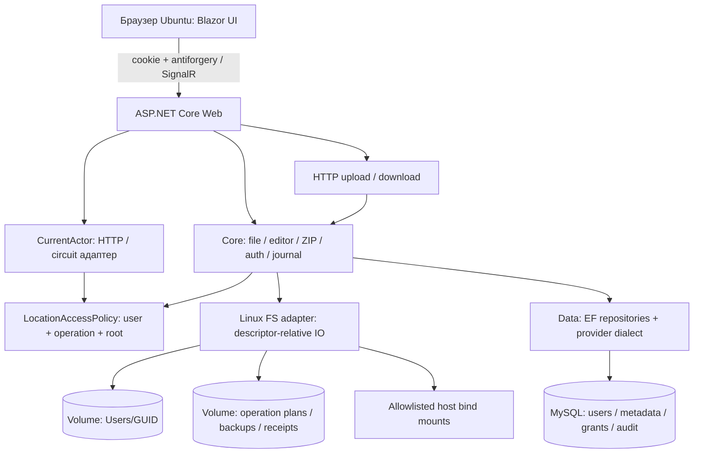

# Целевая архитектура Secure File Manager Web

Дата: 07.11.2026. Статус: предложение этапа12, **реализация не начата**.
Baseline: [аудит HEAD9515151](CURRENT_FUNCTIONALITY_AUDIT.md). Все новые проекты,
типы и маршруты этого документа — будущие компоненты, а не существующий код.

## 1. Решение и границы

Рекомендуется ASP.NET Core Blazor Web App с Interactive Server, C# Core-сервисами,
EF Core и MySQL в Ubuntu VirtualBox. Один web instance на первом развёртывании,
одна MySQL, постоянные volumes и несколько явно заданных host bind mounts.
Браузер Ubuntu открывает `http://localhost:8080`; внешний доступ по умолчанию закрыт.
Полноценный UI обслуживает личное пространство **и** разрешённые внешние каталоги,
включая деревья/copy/move/rename/trash/restore/ZIP/recovery. Не вводится Python-перенос,
облако, публичный API или глобальная роль для чтения всех файлов.

Interactive Server выбран из-за уже имеющейся C# orchestration и локальной VM:
меньше дублирования логики, файловая система и БД остаются на сервере. Сетевой разрыв
явно отображается; состояние circuit не считается durable session/operation ledger.
Большие файлы передаются через защищённые HTTP streaming endpoints, не SignalR
сообщениями и не base64 в circuit. WASM не даёт браузеру доступ к дискам Ubuntu хоста
сервера и не заменяет серверную авторизацию.

## 2. Проектная структура и зависимости

| Будущий компонент | Исходная основа и назначение |
|---|---|
| SecureFileManager.Core | сохранить бизнес-сервисы, DTO, results, parsers; добавить LocationRef/operation authorization и platform path policies без EF/UI |
| SecureFileManager.Data | общие EF entities/repositories, provider-specific model/dialect/error translator; не открывает физические файлы |
| Data.Migrations.SqlServer / Data.Migrations.MySql | отдельные snapshots/history migrations, существующие SQL Up/ID сохранить, без переписывания истории |
| Infrastructure.Windows | после отдельного разрешения извлечь Wpf/Infrastructure/FileSystem с сохранением поведения и Windows regression |
| Infrastructure.Linux | LinuxPersonalStorage, LinuxFileStorage, LinuxExternalDocumentStorage, LinuxExternalOperationStorage, разрешённый mount catalog |
| SecureFileManager.Web | Program composition root, Razor components, cookie endpoints, transfer endpoints, web context adapters; Data только composition/инфраструктура |
| Tests.Core / Tests.Linux / Tests.MySql / Tests.Web | выделить переносимые cases, Linux/DB/browser/security suites; старый Tests оставить Windows suite |

Это предлагаемые имена; решение не создаётся сейчас. Не создавать одновременно второй
ORM/DI/MVVM framework. Web использует встроенные ASP.NET Core auth/DI/antiforgery.
Нужны отдельные новые NuGet лишь выбранного MySQL provider, browser test harness и SAST
инструментария в будущих этапах; зависимости/лицензии/lockfile проверять до установки.

## 3. Повторное использование

| Класс/группа | Категория | Что делать |
|---|---|---|
| DocumentValidator,DocumentValidation,DocumentFormat | 1: без изменения алгоритма | TXT/JSON/XML и строгие лимиты; Linux-названия проверяются отдельно до Format |
| PasswordSecurity,IdentityValidation,LoginProtectionPolicy,IClock | 1 | сохранить формат KDF/lockout, обновление package version после compatibility gate |
| ZipEngine,ZipLimits,ArchivePreview/Progress | 1/2 | сохранить stream parser/actual CRC/limits; консервативные Windows-compatible ZIP entry names пока сохранить как policy |
| FileResult,RepositoryResult,AuthOutcome,простые DTO | 1/2 | сохранить безопасные статусы, ввести отдельные HTTP mappings/transfer results |
| FileService + Archives + StorageDiagnostics | 2/3 | сохранить stage/publish/settle,owner/audit; выделить CI path comparison и file locks,не менять ownership на «доступен OS» |
| AuthenticationService,RegistrationService,UserStorageService | 2/3 | сохранить транзакционные проверки/KDF; отделить UserSession.Start/End от desktop singleton, cookie выдаётся только после commit |
| ExternalDocumentService,ExternalFileOperationService | 3 | убрать '\\',uppercase key,абсолютный Windows path как identity; добавить обязательные grants для всех методов по ID/path/recovery |
| ComputerBrowseService,JournalService,SecurityAudit,AuditHealth | 2/3 | прикладные проверки/события оставить; добавить location scope/redaction, actor adapter; health не хранит чужих приватных деталей |
| Entities User/FileRecord/Operation | 2 | GUID/hash/history сохранить, location metadata/audit snapshots/concurrency mapping расширить |
| ExternalDocument,ExternalPathSyntax,RelativePathSyntax | 3 | location+relative path,OS-specific comparisons; Windows syntax policy оставить Windows, Linux policy отдельная |
| AppDbContext/RepositoryBase/transaction stores/probes | 3 | common mapping + SQL/MySQL differences,joined transactions/locks/error codes; см.DB plan |
| PersonalStorage,Windows*Storage,SafeNativeFile,WindowsDriveService/DirectoryReader | 4: Linux-реализация | Win32 handles/kernel32/share flags/drive letters нельзя переносить заменой slash |
| XAML,ResourceDictionary,ViewModels,RelayCommand,CollectionView/Dispatcher,WindowsFileDialogs | 4: новый UI | перенести поведение в Razor/state/dialog services, сохранять Core ports,не ссылаться Web→Wpf |
| WindowChrome/SystemCommands,OpenFileDialog/OpenFolderDialog,Windows ACL UI | 5: неприменимо | browser window/HTML dialogs/upload и server location picker; ACL остаются Linux/оператору |
| Pure parser/KDF/ZIP cases | 1/2 | выделить из UseWPF test project в cross-platform project |
| SQL trigger fault/junction/STA tests | 3/4 | сохранить Windows, написать эквиваленты MySQL/Linux/browser,не переименовывать старый PASS в Linux PASS |

Категория1 означает повторное использование логики, не обещание прежних package binaries
без обновления. Процент переиспользования без реализации/измерения не оценивается.

## 4. Идентичность, сессии и авторизация

Desktop singleton `UserSession` и mutable VM не регистрировать singleton в Web.
HTTP request имеет scoped CurrentActor из проверенного ClaimsPrincipal; circuit имеет
свой adapter через AuthenticationStateProvider. Не сохранять HttpContext на весь circuit.
DbContext создаётся через factory на одну операцию, не живёт весь circuit. Gate/session
revision — per actor/circuit; координация общей ФС — отдельные locks keyed by location/
object, общие для circuit/HTTP. На первом этапе один app instance; масштабирование
без межпроцессной/распределённой координации запрещено.

Cookie содержит подписанный session identifier/subject, не физический путь и не права
из браузера. Предлагается Session record (opaque ID,UserId,IssuedUtc,ExpiresUtc,RevokedUtc,
generation) для отзыва всех вкладок/logout и проверки на каждой файловой команде.
Login/register/logout — обычный antiforgery-protected HTTP POST + navigation reload,
не попытка установить cookie после начала Interactive response. PasswordSecurity и
существующие Users остаются, внедрять полную новую Identity user schema не требуется.
Активность User/session/grants проверять на сервере перед IO и повторно перед publish/
выдачей данных; смена circuit identity уничтожает буферы. Cookie expire/revoke завершает
доступ старого websocket. Нельзя ждать только визуального исчезновения кнопок.

Новая модель: trusted StorageLocation + LocationGrant(UserId,LocationId,permissions).
Permissions: List/Read/Create/Write/RenameMove/Copy/Delete/Restore/Archive/Download/Upload/
Recover. Для Copy нужны Read source + Create destination; Move — source mutation +
destination create и обе границы; Restore — текущие права исходного location и receipt.
Personal всегда owner-scoped. Shared root может иметь одинаковые grants нескольким
аккаунтам, сохраняя прежний сценарий совместной работы. По умолчанию external grants нет.
Знание GUID/старого receipt/пути не является правом. Полная модель —
[LINUX_FILESYSTEM_ACCESS](LINUX_FILESYSTEM_ACCESS.md).

## 5. WPF → Blazor: все экраны и поведение

| Маршрут/компонент (предложение) | WPF-основа и новая реализация |
|---|---|
| /login,/register | AuthenticationWindow/Login/Register: формы с labels,password,validation,busy,connection retry; antiforgery,без сохранения passwords в state/localStorage |
| MainLayout | MainWindow: header/logo,6 nav items,current user,storage/audit cards,footer logout; CSS Grid вместо WindowChrome |
| /drives | DrivesView: доступные locations/FS capacity,вкладка внешнего browser; не список всех block devices контейнера |
| DirectoryBrowser | ComputerBrowserView: location picker,logical address,up/root/refresh/search/sort/notes,external actions menu и recovery |
| /files | FilesView: personal breadcrumb,create/open/delete/import/sync/recover,selection/ZIP/progress/cancel; reusable table |
| /formats | FormatsView: тот же browser JSON/XML+folders,без вымышленного YAML |
| /archives | ArchivesView: ZIP browser + source selection,preview modal,target directory/new folder picker |
| /journal | actor-only pageable grid,type/result/date/search/direction/reset,next/previous; UTC queries,явный timezone display |
| /settings | version/session/policy/limits,health probe и personal consistency report; права root/секреты не редактируются обычным пользователем |
| DocumentEditor | TextEditorWindow: tabs или route/modal keyed(scope,location,id),10МиБ,mono textarea,Save/Validate/Reload,Ctrl+S,dirty/conflict |
| Name/Confirm/ArchivePreview/Target dialogs | HTML dialog/focus trap/Esc/Cancel/return focus; default safe action; server picker ограничен grants |

DataGrid/ICollectionView → HTML table/virtualized rows с числовой/date sorting,
observable VM → scoped component state, ICommand → async handlers с server command
service, converters → safe formatting/CSS classes. Наличие UI-handler не переносит
в него проверку доступа. Native file/folder picker назначения заменяется выбором
server location/directory; browser upload picker выбирает только клиентские файлы.

Сохранить PNG из Wpf/Assets как локальные static assets в будущем wwwroot/theme,
проверив docs/ASSETS и право распространения (указано предоставление пользователем,
не универсальная лицензия для любых публикаций). CroppedBitmap crop воспроизвести
через wrappers/object-position; полные PNG не менять. Все токены Colors.xaml перевести
в CSS custom properties, opacity textures .25; eye/winged sun/lotus/ibis/Anubis оставить
декором с alt="", meaningful icons — accessible names. No CDN/remote fonts/telemetry.
Использовать system-ui/serif/monospace fallbacks Ubuntu без поставки Windows fonts.
Концепт — ориентир, не фон готового UI. Все тексты русские.

Acceptance UI:1024×640 и1440×900,100%/150% browser zoom,keyboard Tab/Enter/Esc/Ctrl+S,
visible focus,empty/loading/denied/conflict/recovery/disconnected states. На узком окне
toolbar переносится, sidebar сворачивается, таблица скроллится, decoration не перекрывает
контент. Индикатор «Аудит активен» только с датой фактического подтверждения/expiry.

## 6. Передача файлов и состояние операций

Upload: authenticated multipart streaming POST принимает locationId+relative directory,
проверяет Upload/Create grants, имя (не client FullName/path),actual byte limit100МиБ,
disk/quota budget и timeout. Сначала private staging/CreateNew, затем текущий metadata+
audit/publish/recovery protocol. Результат пока не подтверждён — не показывать Success.
Content-Type/размер из браузера недоверенные. Upload arbitrary bytes не запускает файл
и не разрешает text edit неподдержанного формата. Сформировать stream-import port:
нынешний ImportSelection.SourcePath нельзя получать из HTTP клиента.

Download: отдельный авторизованный GET/POST-ticket endpoint по opaque resource ID +
LocationRef, повторные grant/active/session/physical checks, audited opened version,
bounded streaming. Content-Disposition attachment с framework-encoded filename,
application/octet-stream,nosniff,Cache-Control:no-store. Никакой выдачи Storage как
static files/UseStaticFiles. Не отдавать HTML/XML/SVG inline. На старте Range отключить
или отдельно спроектировать повторные ranges/grants/budgets. Это новая web-возможность,
не найденный WPF Export. «Передано сервером» не равно «пользователь сохранил на диск»:
события started/completed/aborted,счётчик отправленных bytes,без ложного подтверждения
доставки при разрыве/DB failure после начала HTTP response. До открытия потока нужен
успешный audit/preflight; поздний audit failure запрещает следующие операции и фиксирует
неопределённость, уже отправленные байты вернуть нельзя.

Editor: текст передавать как данные,ограничить body/text UTF-8 до10МиБ,version token/ETag,
invalid save без изменений,409 Conflict оставляет буфер. JSON/XML validation с safe
line/position без payload. NavigationLock + beforeunload dirty warning; браузер может
не позволить произвольный текст/сохранение при закрытии вкладки. Надёжный Save/Discard/
Cancel при внутренних переходах; не обещать сохранение при crash браузера. После logout
dirty prompt согласуется до POST,но истёкшая сессия не позволяет save; не писать буфер
в localStorage или журнал. При disconnect явно предупредить о риске потери circuit.

Operation ID и bounded progress per authenticated session; UI обновляет статус,а не
перезапускает mutation при reconnect. HTTP retries без duplicate IO: idempotency key
привязан к actor/request/location,операционный ledger/SQL correlation. Cancellation до
publish отменяет подготовку; committed outcome не называется отменённым. Core сохраняет
verified rollback/recovery,не запускает background cleanup пользовательских данных.

## 7. Веб-безопасность и обязательные тесты

| Угроза | Проектная мера | Обязательный тест |
|---|---|---|
| Auth/bruteforce | KDF600000,existing sliding lockout + bounded IP/session rate limits,uniform error | unknown/inactive/locked identical; concurrent failures |
| Cookie/session | HttpOnly,SameSite=Lax/Strict,short explicit idle/absolute TTL,rotation on login,server revoke | old cookie/circuit after logout/expiry denied,две вкладки/два пользователя |
| CSRF | antiforgery login/register/logout/upload/mutations; GET без mutations,Origin/host checks; SameSite лишь доп.мера | чужой origin/нет/подмена token не меняют ФС |
| XSS | Razor encoded filenames/content,textarea,без MarkupString для input,attachment-only uploads,CSP без лишних разрешений | HTML/script в имени/JSON/XML/ошибке/журнале не исполняется |
| IDOR | lookup→location grant→physical boundary для всех ID/path/preview/recover/download | A подставляет fileId/location/receipt B,не получает даже metadata |
| SQLi | existing LINQ/parameters,provider dialect only trusted structure | login/search/name payloads literal на MySQL |
| Path/links/TOCTOU | descriptor-relative IO,deny symlink/magic links/special files/hardlinks/nested mounts,grants | traversal/encoding/mount swap/parent rename/concurrent writer tests |
| XML/ZIP | прежние bounded parsers,XXE/Slip/Bomb/CRC guards,не исполнять загруженное | исходные malicious cases + реальный Linux destination |
| Resources |100МиБ upload,10МиБ text,ZIP limits,quotas/concurrency/timeouts/circuit/body limits | chunked fake Content-Length/slow upload/parallel clients/disk exhaustion isolated |
| Audit/errors | actor/UTC/result/object/correlation,mandatory before result,commit/rollback distinction,safe error code | DB outage/audit insert failure/ambiguous commit,нет ложного Success |
| Secrets/container | runtime secrets files,least DB grants,non-root,restricted mounts,no socket/no caps | image/Git/artifacts без secrets,deny outside mounted locations |

HTTP loopback profile явно не устанавливает Secure cookie (иначе http://localhost:8080
не годится как переносимое production-предположение). Это разрешается лишь локальным
профилем bind127.0.0.1,без удалённого доступа/VM port forwarding; antiforgery остаётся.
Для любого non-loopback развёртывания обязательны HTTPS,Secure cookie,валидный cert,
HSTS в соответствующем профиле; не отключать TLS validation к MySQL молча. Точный
HTTP/HTTPS профиль нужно утвердить до реализации.

## 8. Развёртывание и решения до реализации

Docker multi-stage SDK→publish→ASP.NET runtime без исходников/SDK/секретов,non-root UID/GID;
rootfs read-only,cap_drop ALL,no-new-privileges,ограниченные writable volumes/tmpfs/resources.
MySQL data только MySQL; app-files/app-state/DP-keys только web. Trusted migration job
после healthy DB перед ready web,отдельные DDL credentials. Секреты через runtime files,
не Docker ARG/image labels/конфиг Git. Private DB network,MySQL port не публиковать,
web publish127.0.0.1:8080:8080. Подробности: [Linux access](LINUX_FILESYSTEM_ACCESS.md),
[DB plan](DATABASE_PROVIDER_PLAN.md),[CI requirements](CI_CD_REQUIREMENTS.md).

Предположения P12-01..05 (не изменение действующей Windows-политики): Interactive Server;
один web instance; allowlisted locations с deny-default grants; новый отдельный MySQL;
external trash same-FS без автоочистки. Они записаны также в docs/DECISIONS.md как
предложения,не фактически включённые настройки.

До разрешения реализации решить: получить текст задания№2/срок сдачи,подтвердить стек и
допустимость act,выбрать Ubuntu/kernel/VM resources и версии provider,список host roots/
UID/GID/пользовательских grants,HTTP localhost или HTTPS,политику Linux case sensitivity,
права на распространение ресурсов при публикации. Пока эти детали не подтверждены,
план предоставляет безопасные значения по умолчанию,но не называет их согласованными.

## 9. Проверенные внешние основания (07.11.2026)

- [Blazor security .NET10](https://learn.microsoft.com/en-us/aspnet/core/blazor/security/?view=aspnetcore-10.0): circuit auth/antiforgery/scoped state. Отсюда вывод о необходимости заменить desktop singleton identity; это проектный вывод,не автоматическая миграция.
- [ASP.NET antiforgery](https://github.com/dotnet/AspNetCore.Docs/blob/main/aspnetcore/security/anti-request-forgery.md): cookie authentication требует защиты от CSRF.
- [Docker bind mounts](https://docs.docker.com/engine/storage/bind-mounts/): host filesystem предоставляется явно; не автоматическая видимость дисков.
- [Compose startup order](https://docs.docker.com/compose/how-tos/startup-order/): running не равно ready,нужны health/completion dependencies.

Полный план задач/критериев — [DEVELOPMENT_ROADMAP](DEVELOPMENT_ROADMAP.md).
