# Поэтапный план реализации Web-версии

Дата07.11.2026. **Все WP01–WP12 запланированы,не начаты.** Этап12 текущего поручения —
аудит и документы,не первый этап реализации Web. Следующий шаг выполняется только по
отдельному разрешению пользователя. Предлагаемые branch/projects/files сейчас не создаются.

Комплект:
[Аудит](CURRENT_FUNCTIONALITY_AUDIT.md) · [Архитектура](CROSS_PLATFORM_ARCHITECTURE.md) ·
[Parity](WINDOWS_LINUX_PARITY.md) · [Linux FS](LINUX_FILESYSTEM_ACCESS.md) ·
[БД](DATABASE_PROVIDER_PLAN.md) · [CI/CD](CI_CD_REQUIREMENTS.md).

## 1. Зависимости и правила выполнения

```mermaid
flowchart LR
  WP01[WP01 baseline и версии] --> WP02[WP02 общая логика/контракты]
  WP02 --> WP03[WP03 Linux private adapter]
  WP03 --> WP04[WP04 locations/grants/external IO]
  WP04 --> WP05[WP05 MySQL provider]
  WP05 --> WP06[WP06 Web auth/shell/transfers]
  WP06 --> WP07[WP07 полный файловый workflow]
  WP07 --> WP08[WP08 тема/UX/accessibility]
  WP08 --> WP09[WP09 Docker deployment]
  WP09 --> WP10[WP10 parity/security acceptance]
  WP10 --> WP11[WP11 локальный CI/CD]
  WP11 --> WP12[WP12 финальная сдача]
```

Разделение filesystem policy надо определить уже WP02 до Linux IO;WP04 реализует
её external grants,WP05 сохраняет её в MySQL. WP03–04 проверяются headless с изолированными
fixtures;реальная SQL/MySQL consistency — WP05/07. Native capability и version spike WP01
не является развёртыванием working Web. Каждый WP разбивается на указанные небольшие
поручения;следующий WP не выполняется автоматически. Не ждать WP10,чтобы впервые
проверить безопасность/сборку:локальные acceptance обязательны у каждого WP.

После разрешения любого WP:read current Git/docs,сохранить чужие изменения,минимальная
реализация,связанные tests на правильной платформе,обновить PROGRESS/DECISIONS/TASKS
фактически. Ошибка среды →точный blocker,не закрытая галочка. Не изменять рабочую SQL DB
и не использовать реальные home/Storage как fixture. Не создавать commit без поручения.

## WP01. Baseline,ветка,среда и окончательная матрица версий

**Цель:** сохранить проверяемую Windows базу и утвердить условия переноса.
Зависимость:одобрение результатов этапа12 и разрешение WP01.

Небольшие задачи:

1. Зафиксировать baseline commit9515151/актуальный user commit,чистоту и чужие изменения;
   создать `codex/cross-platform-web`/изолированный worktree по фактической доступности,
   без коммита и без изменения рабочего deployment.
2. Получить полный текст задания№2;проверить Ubuntu version/kernel/VirtualBox resources,
   Docker/Compose/.NET10 availability и Linux native syscalls. Выбрать roots/UID/GID.
3. Проверить package lock candidate .NET10/EF10/Oracle10.0.12/MySQL8.4 в отдельном spike
   после разрешения на isolated dependencies/DB,сверить license/CVE/tool versions.
4. Утвердить HTTPlocalhost/HTTPS,CI act vs GitLab,case policy и threat model.

Основные файлы:global.json/common csproj **только будущей ветки**,docs decisions,
environment manifest/семестровые requirements,отдельный spike artifact. Reuse:весь
baseline/194-case evidence. Новое:compatibility report,не готовый file manager.

Tests:isolated restore/build/provider basic model/CRUD/lock/concurrency/UTC;native
openat2/renameat2 availability;Windows baseline regression только безопасным согласованным
способом. Acceptance:explicit chosen version graph с результатами,никаких EF-major
warnings/preview assumptions,baseline доступен отдельно,formal gaps перечислены.
Риски:VS2022 vs net10,EOL9.0,provider behavior/license,ресурсы VM. Ручная проверка:
Ubuntu shell/browser,VM network localhost-only,no data mounts changed.

## WP02. Платформенно независимые контракты и тесты

**Цель:** сохранить Core algorithms,убрать Windows semantics из общих external workflows.
Зависимость:WP01 version/threat decisions.

Задачи:выделить Windows infrastructure из Wpf без изменения поведения;ввести LocationRef/
IPathPolicy/comparer/external key abstraction;отделить CurrentActor/session port от
desktop singleton;выделить tests.Core. Не создавать UI или Linux filesystem CRUD здесь.

Файлы/проекты:Core/Files/ExternalDocumentService.cs,ExternalFileOperations.cs,Security/
ExternalPathSyntax/RelativePathSyntax,Interfaces/security services,Data metadata validators;
новые Infrastructure.Windows/Tests.Core при согласованном проектном решении.
Reuse:DocumentValidator,ZipEngine/limits,KDF,results,FileService/архивные orchestration.
Новое:location-aware DTO/path canonicalization,actor adapters contract,versioned plan shape.

Tests:pure parsers/KDF/ZIP на Linux+Windows,две path policies/case/Unicode,Core без
WPF/EF refs;Windows regression подтверждает unchanged personal/shared behavior.
Acceptance:общий Core не склеивает external '\\'/uppercase Windows keys для Linux,
net10 target совместим,Windows API остаётся за Windows adapter,тесты не требуют WPF
для pure cases. Риски:смена path identity/stable GUID/serialized plans,не потерять
Windows recovery backwards compatibility. Ручная проверка:Windows demo workflow после
извлечения adapter,никаких операций с рабочими файлами.

## WP03. Linux-адаптер личного хранилища

**Цель:** безопасный personal CRUD/stream IO и recoverable preparation на ext4.
Зависимость:WP02;проверенные capabilities WP01.

Задачи:Linux provisioner/root validation;native root-FD open/fstat/path controls;
List/Inspect/Read/OpenBinary;Create/Save/Delete-empty/Import-stream/StageGenerated/
Publish/Settle/Pending;fsync данных/каталогов,схема plans и safe cleanup.

Файлы:Infrastructure.Linux/LinuxPersonalStorage,LinuxFileStorage,LinuxNativeFile;
Core существующие IPhysicalFileStorage/IFileWorkspace/IFilePreparation,Tests.Linux.
Reuse:FileService.Archives,DocumentValidator,ZipEngine,owner policy/operation protocol.
Новое:native Linux descriptor-relative IO и locks,version fingerprint/precision handling.

Tests:actual temp FS CRUD/UTF8/BOM,symlink/hardlink/FIFO/special objects,CreateNew/no
overwrite,concurrent saves,parent replacement,limits,prepared/cancelled trees;crash
checkpoint before/after publish с fake transaction decision только как unit contract,
не вместо MySQL integration. Acceptance:no escape/unknown deletion,private owner
boundary,deterministic recovery of verified artifacts;unsupported syscall→fail closed.
Риски:POSIX locks advisory,rename ancestor,ACL replacement semantics/fsync durability.
Ручная проверка:Linux mode/umask/ACL,expected permission errors,без root web execution.

## WP04. Несколько locations,grants и внешние Linux-операции

**Цель:** полноценный доступ к нескольким разрешённым Ubuntu папкам при одном process UID.
Зависимость:WP03 и approved location/permission model WP02.

Задачи:trusted catalog/mount identity/availability;LocationAccessPolicy default deny;
external list/editor/copy/move/create;trash/receipts/restore/ZIP и recovery в тех же
bounded orchestration. Разбить минимум на WP04a catalog+policy,WP04b editor+CRUD/copy/
move,WP04c trash/ZIP/recovery,с отдельной приёмкой каждого блока.

Файлы:Core/Files/ComputerBrowsing,ExternalDocumentService,ExternalFileOperations;
Infrastructure.Linux/LinuxComputerDirectoryReader/LinuxExternalDocumentStorage/
LinuxExternalOperationStorage;contracts LocationGrant repository;Tests.Linux.
Reuse:shared GUID/audit/correlation protocols,limits,ZipEngine. Новое:grants для source/
destination/ID/receipt/recovery,logical paths,no nested mount bypass.

Tests:usersA/B с разными grants в одном UID;IDOR всех entry points,source/dest mixed
rights,ro root,overlap/alias,symlink/magic link/hardlink/nested bind,EXDEV/no overwrite,
original-file write rights,tree1000/100МиБ/1ГиБ,changed receipt recovery,USB marker absence.
Acceptance:операции запрещены до IO без grant,shared root работает только разрешённым,
private/state/keys недоступны через external routes,Windows baseline behaviors сохранены.
Риски:OS token не app isolation,untrusted parent races,exfat/vboxsf semantics,receipt
lifecycle. Ручная проверка:два каталога разных FS,read-only дополнительный носитель,
permission-denied,запрет системных roots;без host-agent/physical mount API.

## WP05. MySQL provider и persistence новой модели

**Цель:** настоящая EF/MySQL integration,SQL Server provider остаётся поддержанным.
Зависимость:WP04 logical metadata/grants/plan model;provider spike WP01.

Задачи:common/provider model profile/dialect/errors/Joined transaction factory;
отдельный MySQL initial и migration assembly;portable concurrency token/unique active
path/UTC precision/login keys;location grants/session schema;probes/readiness/secrets.

Файлы:Data/AppDbContext,Repositories,Identity,Files,Configuration,DI,design-time factory,
Data.Migrations.SqlServer/MySql,Tests.MySql. Reuse:entities GUID/KDF/audit history,
LINQ queries,repository contracts. Новое:MySQL locks/exceptions/mapping/DDL,grant/session
repositories. SQL existing migration IDs/history и рабочую БД не менять.

Tests:все DB plan acceptance на реальном InnoDB,две providers model-cache isolation,
rollback/audit faults/unknown commit/FS recovery совместно WP03–04,exact mtime token,
case/Unicode/soft-delete path reuse/append-only. Acceptance:нет T-SQL в MySQL execution,
fresh separate schema сохраняется между подключениями,граф EF majors согласован,
runtime не делает auto-DDL. Риски:generated unique keys,datetime precision,locking/deadlock,
provider LINQ translation/license. Ручная проверка:SQL history unchanged read-only,
MySQL permissions/backup restore demo,никакого переноса production users.

## WP06. ASP.NET Core/Blazor foundation,auth и HTTP transfers

**Цель:** работающий authenticated browser shell с безопасным переходом к Core.
Зависимость:WP05;именно здесь впервые создаётся Web-проект.

Задачи:composition root/scoped circuit+HTTP actor;cookie login/register/logout/server
session revoke/antiforgery;6 routes/shared shell;stream upload/import и download handlers,
server location picker. Разбить auth/session и transfers на отдельные небольшие задачи.

Файлы:Web/Program.cs,Auth,Endpoints,Components/Layout,Pages/login/register,
CurrentActor adapters,stream-import contract,Tests.Web. Reuse:auth/KDF/Core services/
repository decisions. Новое:cookie/session context,HTTP statuses/headers/CSRF/body quotas,
safe circuit lifetime/reconnect/idempotency.

Tests:две независимые browser sessions/tabs,expired/revoked cookies+old circuit,CSRF
all POSTs,IDOR route/body/query,upload real-byte limits/fake names/lengths,download
attachment/nosniff/no-store,stream abort/audit semantics;no singleton state leaks.
Acceptance:login only after SQL commit,DB unavailable blocks files,ни один storage
каталог не static served,перенос не ограничен API demo. Риски:HttpContext circuit lifetime,
HTTP Secure cookie profile,stream already sent vs audit failure. Ручная проверка:
браузер Ubuntu login/logout/upload/download,готовые/непроверенные статусы честны.

## WP07. Полный функциональный workflow в браузере

**Цель:** закрыть применимые строки parity до визуальной полировки.
Зависимость:WP06 и headless adapters WP03–05.

Небольшие задачи:WP07a disks/external+personal navigation/search/sort/CRUD/sync;
WP07b editor TXT/JSON/XML/dirty/conflict/reload;WP07c copy/move/rename/trash/restore;
WP07d personal+external ZIP/progress/cancel limitations/recovery;WP07e journal/settings/
diagnostics. Каждый slice имеет E2E и собственную демонстрацию,не одна огромная правка.

Файлы:Web/Components/DirectoryBrowser,FilesTable,Editor,ArchiveDialogs,Journal,Settings,
operation status service;Core лишь необходимые port refinements. Reuse:все existing
services/validators/limits/metadata/audit,не второй CRUD implementation.
Новое:HTML interactions/server dialogs/resource-action state,opaque operation IDs.

Tests:каждая parity function,UTF8 malformed JSON/XML/DTD,ZIP malicious/CRC/limits,
binary+empty folder round-trip,dirty/navigation close,concurrent editors/rename,DB
failure/recover/foreign ID,permissions all methods. Acceptance:все реальные WPF actions
доступны функционально,отличия браузера/Docker названы,нет YAML/editor/export claims
из воздуха;new upload/download реализованы целиком. Риски:scope creep/пропуск private
vs external различий,двойной submit/reconnect/длительные транзакции. Ручная проверка:
обычный полный пользовательский сценарий с двумя аккаунтами и учебными файлами.

## WP08. Египетская тема,адаптивность и доступность

**Цель:** узнаваемый полноценный GUI,без декоративных заглушек.
Зависимость:WP07;базовая функциональная разметка уже есть.

Задачи:18PNG локально,CSS tokens из Colors.xaml/SourceRect crop,header/sidebar/footer,
cards/table/dialog styles;responsive1024×640,150% zoom;keyboard/ARIA/focus/empty/error/
offline/dirty states;safe user content encoding. Не генерировать новый набор ассетов.

Файлы:Web/wwwroot/theme,Components/Layout/shared controls,styles;docs/assets map и
browser screenshots. Reuse:palette,logo/icons/ornaments/textures,UX six sections.
Новое:CSS Grid/flex/system fonts/HTML dialog controls,никакого XAML runtime.

Tests:browser screenshots на synthetic fixtures,accessible labels/focus order/keyboard,
XSS payload filename/content/audit,forms labels,table numeric sort,decor not blocking.
Acceptance:все actions действуют либо disabled с причиной,нет fake «защищено»/audit active,
UI читабелен1024×640/1440×900 при100/150%,no remote CDN/fonts. Риски:Ubuntu fonts,
image crop/licensing/browser zoom. Ручная проверка:в Ubuntu реальные Tab/Enter/Esc/
Ctrl+S,dialogs/save-discard-cancel,scroll,соответствие reference и ограничения browser close.

## WP09. Docker Compose полноценного приложения

**Цель:** повторяемая установка на Ubuntu,все данные переживают recreate.
Зависимость:WP08;schema/FS/web security acceptance предыдущих WP.

Задачи:multi-stage Dockerfile/.dockerignore,Compose web+mysql+migration profile,
named files/state/keys/db volumes и explicit bind roots;non-root provisioning/secret files;
healthy DB→migrate→ready Web,loopback publish;backup/restore и rollback instructions.

Файлы:Dockerfile,compose.yml,deploy/example mounts config/provisioning docs,readiness/
liveness endpoints,tests deployment smoke. Reuse:опубликованный Web image/Core/DB/
Linux providers;новое:runtime isolation/ownership bootstrap/migration job.

Tests:fresh compose и restart/recreate,DB schema readiness/audit INSERT permissions,
wrong mount marker/ro grant,secret absence,image dependency scan,service unavailable
fail closed,port isolation. Acceptance:browser localhost8080 выполняет все workflow,
MySQL port наружу закрыт,rootfs readonly/least caps,web не root/privileged/docker.sock,
две host locations доступны только по grants,persistence verified. Риски:bind ACL,
rootless mappings,VM memory/disk,entrypoint init/health tool availability. Ручная проверка:
VirtualBox restart/USB demo/два mount FS,network denial извне,backup restore rehearsal,
никакого mount всего `/` rw.

## WP10. Совместимость и security acceptance

**Цель:** доказать full parity и границы безопасности на actual Ubuntu Docker.
Зависимость:WP09;не заменяет tests предыдущих WP.

Задачи:пройти каждую строку WINDOWS_LINUX_PARITY,сверить bytes/tree/GUID/history/UTC,
провести multi-user/auth/session/CSRF/XSS/IDOR/links/race/ZIP/resource denial tests,
контролируемые DB/IO/ambiguous commit/restart checkpoints;заполнить evidence matrix.

Файлы:Tests.Core/Linux/MySql/Web + docs acceptance reports/synthetic screenshots,
parity статусы. Reuse:существующие194 Windows cases как baseline и новые portable tests.
Новое:cross-platform scenario corpus с безопасными fixtures и browser evidence.

Acceptance:все обязательные строки PASS либо согласованное функциональное отличие;
нет skipped mandatory integration и High/Critical;реальная GUI/permissions приёмка
подтверждена. Windows no-regression отдельно на Windows,не тестируется WPF на Linux.
Риски:непроверенный filesystem/physical power loss,администратор вне threat model,
same UID hostile writers,аппаратные tests не подменять mocks. Ручные проверки:
native browser zoom/keyboard/dirty/file transfer,read-only and removable mounts,
последовательность двух аккаунтов,clean install на новой VM/данных.

## WP11. Локальный CI/CD

**Цель:** автоматические Build→Test→SAST→Package/scan→Local Deploy→Smoke с hard gates.
Зависимость:WP10 плюс подтверждённый вариант CI/текст задания№2 WP01.

Задачи:shared ci scripts и выбранный workflow/runner,local cache/artifacts,gates severity
mapping,failure proof,secrets separation,deploy lock/timeouts;event trigger по выбранному
согласованному профилю. Технический YAML не создавать до завершения архитектурного выбора.

Файлы:ci/*.sh,выбранный .github/workflows/local.yml **либо** .gitlab-ci.yml,SAST rules/
policy config,CI evidence docs. Reuse:рабочие tests/Docker image/Compose/migrate/smoke.
Новое:orchestration/hard fail gate/retention/manifests/secret provisioning.

Tests:clean success run/cache hit;build/test fail останавливает;High/Critical fixtures
не дают deploy;scanner error/unknown report тоже block;artifact available after failure;
concurrent deploy lock;untrusted branch не получает secret. Acceptance:каждая стадия
реально выполнена локально,проверенный image commit задеплоен,MySQL/files untouched by
CI cleanup,полные evidence задания. Риски:act unsupported features,Docker permissions,
scanner CE coverage/false positives/DB freshness. Ручная проверка:запуск pipeline из
документированного trigger,просмотр reports/artifacts,проверка установленной версии и
сохранности учебных данных после неуспешного конвейера.

## WP12. Финальная сдача,чистая установка и документация

**Цель:** воспроизводимая Ubuntu Web-версия и проверяемый учебный отчёт.
Зависимость:WP11,все parity/security/manual обязательства закрыты.

Задачи:clean VM deployment по README,backup/restore/update/rollback runbook,requirements
traceability к оригиналу задания№2,финальные GUI/CI screenshots на demo,список known
limits,актуальные versions/links/decisions/progress. Никаких выдуманных PASS/скриншотов.

Файлы:README Web/deploy/security/backup/test reports,docs/cross-platform итоговые matrix,
semester report/artifact manifest. Reuse:весь проверенный functional/test/deploy комплект.
Новое:release handoff/операторская инструкция/полный evidence index.

Tests:финальный pipeline и independent clean-install smoke;проверка local links/secrets
в артефактах,restore отдельной demo backup,immutable version/image match. Acceptance:
пользователь в Ubuntu browser выполняет полный файловый сценарий,не API demo;requirements
с источником и доказательством,данные сохраняются,секреты не распространяются.
Риски:недоступная clean VM/backup medium/формальная методичка;при этом статус Partial,
не Complete. Ручная проверка:демонстрация преподавательского сценария,USB/bind optional
матрица,keyboard/zoom,контроль localhost,устойчивые данные после restart.

## 2. Общие release gates

- Functional:все применимые строки parity,включая shared external trees/trash/restore/
  ZIP/diagnostics/journal;нет silent сокращения до personal Storage.
- Security:server grants/owner+OS boundary на каждом entry point,CSRF/XSS/IDOR/SQL/path/
  XML/ZIP/resource tests;mandatory audit/неопределённые outcomes честны.
- Data:MySQL schema/metadata/history и FS согласованы после success/rollback/recovery;
  в crash ambiguity данные сохраняются;тестовый cleanup не касается runtime volumes.
- Platform:реальные Ubuntu/Kernel/MySQL/Docker/native/browser результаты,не один mock
  или Windows screenshot,переименованный в Ubuntu.
- Windows:исходная установка/SQL/Storage не тронуты;если общая ветка меняла shared
  код,отдельная Windows regression до слияния. Нет автоматического коммита/миграции.

## 3. Главные риски

| Приоритет | Риск | Момент снятия/ограничение |
|---|---|---|
| P0 | singleton identity/отсутствие web grants→межпользовательский доступ | WP02/04/06,две sessions+IDOR tests,до первого доступа Web к FS |
| P0 | перенос Win32 protections обычным System.IO→path/link/race ошибки | WP03/04,native Linux tests и explicit residual threat model |
| P0 | потеря данных из-за неверного FS/DB rollback/неопределённого commit | WP03–05/07,versioned plans/SQL correlation/no blind cleanup |
| P0 | секреты/Docker control/root mount доступны web или CI untrusted source | WP06/09/11,least privileges/isolated trusted runner |
| P1 | EF9 EOL/EF10-provider несовместимость/VS2022 | WP01/05 compatibility spike,не suppress version errors |
| P1 | case/Unicode/mtime precision/key collisions меняют identity | WP02/05,явные policies/real MySQL/Linux tests |
| P1 | USB/nested mounts/vboxsf/NTFS отличаются от ext4 | WP04/09,filesystem-specific support matrix;Unavailable вместо fallback |
| P1 | browser reconnect/large editor memory/late download audit | WP06–08,streaming/budgets/idempotency/truthful statuses |
| P1 | нет текста задания№2,act может не подходить формально | WP01,получить/сверить requirements до CI implementation |
| P2 | native Windows11.04/clean install ещё открыты | не считать Windows baseline полностью принятой версией без подтверждения |
| P2 | ресурсные/лицензионные/полнота scanner ограничения | WP01/08/11,зафиксировать применимые лицензии/tool coverage |

## 4. Вопросы до начала реализации

1. Где полный текст/файл задания№2,когда сдача и требуется ли конкретный CI/SAST tool?
   Допустим ли act с local trigger или нужен GitLab coordinator+Runner?
2. Какая Ubuntu/kernel/архитектура,сколько RAM/CPU/disk у VirtualBox,есть ли Docker/SDK10?
   Разрешено ли обновление IDE доVS2026 для общей Windows net10 ветки либо нужен net9 build?
3. Какие именно Ubuntu каталоги/диски доступны Web,какие ro/rw,UID/GID/ACL,какие grants
   каждому app-пользователю? Разрешён ли общий workspace всем как в Windows?
4. Нужно ли динамическое hotplug/mount управление? Baseline — операторское монтирование,
   без host-agent;mount management текущая WPF тоже не предоставляет.
5. Утверждается ли exact-case external Linux policy и conservative CI ZIP names?
   Нужна ли обработка имён ext4,которые несовместимы с Windows naming policy?
6. Остаётся новая отдельная MySQL база без миграции пользователей? Рекомендация — да;
   будущая миграция пользователей/данных требует отдельного задания/backup rehearsal.
7. Достаточен ли строго loopback HTTP8080 для учебной демонстрации или нужен HTTPS?
   Сеть VM/port forwarding не должны незаметно открыть приложение наружу.
8. Какой объём runtime данных/quota/backup storage и способ публикации/распространения
   проекта/PNG/Oracle dependencies допускаются?

Эти вопросы не мешали документальному аудиту;не считаются отвеченными по молчанию.
Приоритет первого отдельного поручения — **WP01**,а не создание Blazor/Docker/CI сейчас.
